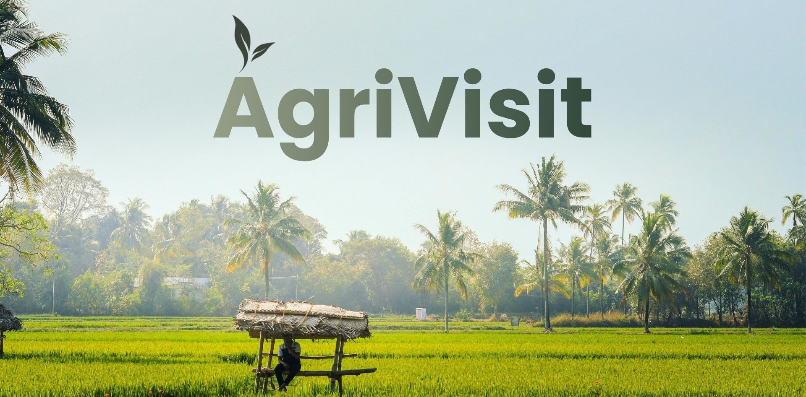

<div align="center">

# AgriVisit

### Online Agritourism Booking and Management System 

> A web-based platform that connects local farms with tourists through interactive farm map, online experience booking, QR-coded e-tickets, and revenue dashboard — promoting local agriculture, accessible tourism, and efficient farm management.


</div>



<br>

---

## Setup: Connecting the Database (Supabase)

1. Copy `.env.example` and rename the copy to `.env` in the project folder.
2. Open `.env` and paste your own Supabase Project URL and anon (public) key after the `=` signs.
3. Never commit `.env` to git. It is listed in `.gitignore` to keep your keys private.
4. Until the database is connected, the app shows sample data from `src/services/agriData.js`.

---

## Unfinished Screens

These screens still need work before the app is complete:

- **Public pages** (Home, Discovery, Experiences, Farm, Checkout, Bookings): still use their own sample data, not the data layer.
- **Sign-in and sign-up** (Login, Tourist Register, Owner Register, Admin Sign-In, Pending Approval): not yet connected to real accounts.
- **Owner farm registration:** the farm location pin is a read-only placeholder.
- **Owner QR check-in:** only a typed ticket code, no camera scan yet.
- **Checkout:** the payment choice is not connected to a real payment.
- **Admin settings:** password and activity note fields need saving logic.

---

## Table of Contents

1. [Project Overview](#project-overview)
2. [Project Objectives](#project-objectives)
3. [Key Features](#key-features)
4. [Core Modules](#core-modules)
5. [User Roles](#user-roles)
6. [Technology Stack](#tech-stack)
7. [UML Diagram](#uml-diagram)
8. [Flowchart](#flowchart)
9. [Developers](#developers)
10. [License](#license)
11. [Acknowledgements](#acknowledgements)

---

<br>

## Project Overview

**AgriVisit** is a web-based agritourism booking and management system developed using HTML, CSS, and JavaScript. It was designed to address the challenges faced by local farms in promoting their agricultural attractions and managing tourist reservations through traditional methods.

Many small and local farms still rely on social media messages, word-of-mouth promotions, and manual record-keeping to accommodate visitors. These methods can make it difficult to organize booking schedules, monitor available slots, track reservations, and maintain accurate visitor records. AgriVisit aims to provide a centralized digital platform where tourists can discover local farms and book agricultural experiences, while farm owners can manage their offerings and monitor reservations more efficiently.

The system covers the main processes of agritourism management: from discovering participating farms through an interactive map and exploring available experiences, to reserving schedules, receiving QR-based tickets, and verifying visitor arrivals. It also provides farm owners with tools for managing farm profiles, activities, booking schedules, and revenue information, while administrators oversee farm registrations, user accounts, and platform content.

**Target Users:**
- Tourists looking for local farms and agricultural experiences to visit
- Farm owners who want to promote their farms and manage tourist reservations
- Administrators responsible for overseeing farm registrations, user accounts, and platform activities

**Core Value Proposition:**
AgriVisit does not simply provide a platform for browsing farms — it connects farm discovery, experience booking, and visitor management in one organized system. By bringing farm information, activity schedules, reservations, and QR-based ticketing together, it aims to make agritourism more accessible to tourists and easier to manage for local farm owners. Ultimately, AgriVisit supports the promotion of local agricultural destinations while helping farms provide a more organized and convenient visitor experience.

<br>

---

## Project Objectives

**General Objectives**

AgriVisit aims to develop a Windows desktop application that provides an organized, transparent, and efficient platform for managing agricultural-related donations, funds, and resource distributions. The system's goal is to improve record-keeping, strengthen accountability, and ensure that every contribution and allocated resource is properly documented and monitored.

**Specific Objectives**

Specifically, the project aims to:
- **Centralize Record Management** – To provide a centralized database for storing and managing records of donors, donations, funds, beneficiaries, and distributed resources.
- **Improve Financial Transparency** – To monitor and document incoming donations, financial transactions, and fund allocations to ensure accurate and transparent financial records.
- **Streamline Resource Distribution** – To organize and track the distribution of agricultural resources and other forms of assistance to intended beneficiaries.
- **Strengthen Accountability** – To maintain detailed transaction histories and audit trails that allow authorized users to monitor activities and verify recorded transactions.
- **Provide Role-Based Access** – To implement user authentication and role-based permissions that restrict access to system features according to assigned responsibilities.
- **Generate Reports** – To generate organized reports containing donation records, financial summaries, and resource distribution information for monitoring and decision-making.
- **Ensure Data Reliability and Security** – To utilize a structured relational database and appropriate security measures to maintain data consistency, protect sensitive information, and support reliable system operations.

<br>

---

## Key Features

- **User Registration and Authentication** – Provides account registration, secure login, and role-based access for tourists, farm owners, and administrators.
- **Role-Based Dashboards** – Offers dedicated dashboards and functionalities based on user roles, allowing each user to access the tools and information relevant to their responsibilities.
- **Farm Profile Management** – Allows farm owners to create, update, and maintain their farm information, including descriptions, locations, contact details, and photos.
- **Agricultural Experience Listings** – Enables farm owners to publish and manage their available agricultural tourism activities, including experience descriptions, prices, schedules, and visitor capacity.
- **Farm Search and Filtering** – Allows tourists to discover registered farms and find suitable destinations using filters such as location, experience type, price range, and ratings.
- **Interactive Farm Map** – Displays registered farms through map markers, helping tourists locate agricultural destinations and explore nearby farm experiences.
- **Online Booking and Reservations** – Allows tourists to select their preferred farm experience, visit date, and number of guests when making reservations.
- **Real-Time Slot Availability** – Checks available booking slots based on the selected schedule and visitor capacity to prevent overbooking and maintain accurate reservation records.
- **Booking Management** – Enables tourists to view their booking details, track reservation status, access booking history, and cancel existing reservations.
- **QR Code E-Tickets** – Automatically generates unique QR-coded tickets for confirmed reservations, which tourists can view and download for their scheduled visits.
- **QR Code Scanning and Check-In** – Allows farm owners to scan and validate tourist QR tickets upon arrival to verify reservations and record visitor attendance.
- **Reviews and Ratings** – Allows tourists to share feedback and rate their completed farm experiences, helping other users make informed decisions when choosing destinations.
- **Review Moderation** – Provides administrators with tools to monitor and moderate submitted reviews to maintain appropriate and reliable platform content.
- **Revenue and Booking Dashboard** – Gives farm owners access to booking summaries, visitor records, and revenue information to help monitor their farm's performance.
- **Administrative Management and Reports** – Allows administrators to manage user accounts, approve farm registrations, organize experience categories, monitor platform activities, and generate system-wide reports.

<br>

---

## Core Modules

| Module | Description |
|--------|-------------|
| **User and Role Management** | Handles user registration, login, authentication, and role-based access for tourists, farm owners, and administrators. Allows users to manage their accounts and profile information while ensuring that each role has access to its designated features and functionalities. |
| **Farm and Experience Management** | Allows farm owners to create, update, and manage their farm profiles, including farm descriptions, locations, contact details, photos, and available agricultural tourism experiences. Supports the configuration of experience prices, operating schedules, booking availability, and visitor slot limits. |
| **Farm Discovery and Search** | Enables tourists to browse registered farms, explore available agricultural experiences, and search for destinations based on location, experience type, price range, and ratings. Includes an interactive map that displays farm locations through map markers for easier destination discovery. |
| **Booking and Reservation Management** | Allows tourists to select their preferred farm experience, visit date, and number of guests. Checks real-time booking availability and remaining slots before confirming reservations to prevent overbooking. Also supports reservation management, booking history, and cancellation. |
| **QR Ticket Generation and Check-In** | Generates a unique QR-coded electronic ticket for every confirmed reservation. Allows tourists to view and download their tickets while enabling farm owners to scan and validate QR codes upon visitor arrival for efficient check-in and attendance monitoring. |
| **Reviews and Ratings Management** | Allows tourists to submit ratings and feedback after completing their farm visits. Displays reviews on farm profiles to help other users evaluate available experiences while providing administrators with moderation capabilities to maintain reliable platform feedback. |
| **Reports and Revenue Dashboard** | Provides farm owners with an overview of booking transactions, visitor attendance, and revenue generated from reservations. Allows administrators to monitor system-wide activities, registered farms, user accounts, booking statistics, and platform performance through organized reports and visual summaries. |

<br>

---

## User Roles

**Tourist**

Browse and search for registered farms based on their location, available activities, and other preferences. They can view detailed farm profiles, explore available agricultural experiences, check schedules and booking slots, reserve experiences, view booking details, cancel existing reservations, download QR-coded tickets for confirmed bookings, check their booking history, and submit reviews and ratings based on their farm visit experiences.

**Farm Owner**

Manage and maintain their farm's profile by updating farm information, descriptions, location, contact details, photos, and available agricultural experiences. They can create, edit, and remove experience listings, set operating schedules, configure booking availability and slot limits, monitor incoming reservations, confirm or manage tourist bookings, scan and validate QR-coded tickets for visitor check-ins, track visitor attendance, and access a revenue dashboard to monitor booking transactions and earnings.

**Administrator**

Oversee and manage the entire AgriVisit platform to ensure that all system activities operate properly. They can review and approve or reject farm registration applications, manage tourist and farm owner accounts, monitor registered farms and their information, organize and maintain experience categories, review and moderate submitted ratings and feedback, monitor booking activities and transactions, handle reported concerns, and generate system-wide reports to evaluate platform usage, farm participation, booking trends, and overall system performance.

<br>

---

## Technology Stack

| Technology | Purpose |
|------------|---------|
| HTML | Used to structure the content and elements of the AgriVisit website. |
| CSS | Used to design the layout, styling, colors, and responsive interface of the website. |
| JavaScript | Used to add interactive features, dynamic content, and client-side functionality. |
| Visual Studio Code | Used as the primary code editor for developing and managing the project files. |
| Figma | Used for designing the user interface (UI), creating wireframes, and developing website prototypes. |
| GitHub | Used for source code hosting, project collaboration, and repository management. |

<br>

---

## UML Diagram

<br>

---

## Flowchart

<br>

---

## Developers

<div align="justify">

| Name | GitHub |
|------|--------|
| Von Andrei G. Lunar | [@DreiLunar](https://github.com/DreiLunar)|
| Jisselle Mae M. Silla | [@ellemrsgn27](https://github.com/ellemrsgn27) |
| Lance T. Buenviaje | [@LncBnvj](https://github.com/LncBnvj)|

</div>

<br>

---

## License

``` bash
MIT License
Copyright (c) 2026 FundForest Development Team

Permission is hereby granted, free of charge, to any person obtaining a copy
of this software and associated documentation files (the "Software"), to deal
in the Software without restriction, including without limitation the rights
to use, copy, modify, merge, publish, distribute, sublicense, and/or sell
copies of the Software, and to permit persons to whom the Software is
furnished to do so, subject to the following conditions:

The above copyright notice and this permission notice shall be included in all
copies or substantial portions of the Software.

THE SOFTWARE IS PROVIDED "AS IS", WITHOUT WARRANTY OF ANY KIND, EXPRESS OR
IMPLIED, INCLUDING BUT NOT LIMITED TO THE WARRANTIES OF MERCHANTABILITY,
FITNESS FOR A PARTICULAR PURPOSE AND NONINFRINGEMENT. IN NO EVENT SHALL THE
AUTHORS OR COPYRIGHT HOLDERS BE LIABLE FOR ANY CLAIM, DAMAGES OR OTHER
LIABILITY, WHETHER IN AN ACTION OF CONTRACT, TORT OR OTHERWISE, ARISING FROM,
OUT OF OR IN CONNECTION WITH THE SOFTWARE OR THE USE OR OTHER DEALINGS IN THE
SOFTWARE.

```
<br>
---

## Acknowledgements

We would like to express our sincere gratitude to our project adviser for the invaluable guidance, patience, and support throughout the planning and development of AgriVisit. Their knowledge, constructive feedback, and recommendations have helped us improve our ideas, refine our system design, and overcome the challenges encountered during the development process.

We are especially thankful for the time and effort devoted to guiding us, sharing valuable insights, and encouraging us to continuously improve our work. Their guidance has played an important role in shaping this project and strengthening our understanding of system development.

We would also like to extend our appreciation to everyone who contributed their time, suggestions, and support to the completion of AgriVisit.

To our adviser, thank you for being an important part of our journey in bringing AgriVisit to life.

---

<br>

<div align="center">

AgriVisit was developed with the vision of connecting local farms and tourists through technology, supporting agricultural communities, and making farm experiences more accessible.

If you find this project useful or informative, consider giving the repository a ⭐ on GitHub.

**AgriVisit — 2026**

</div>

## <p align="center"><i>🌱 AgriVisit: A little closer to the good life.</i></p>
